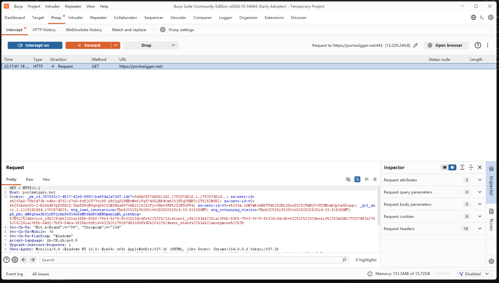
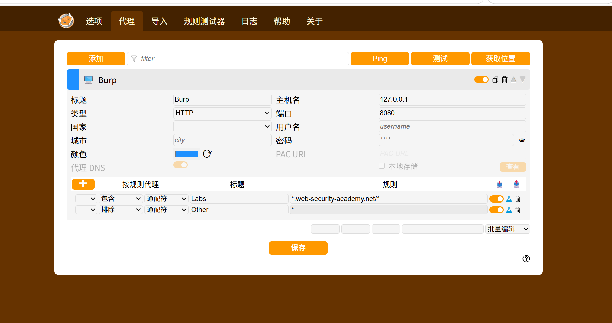
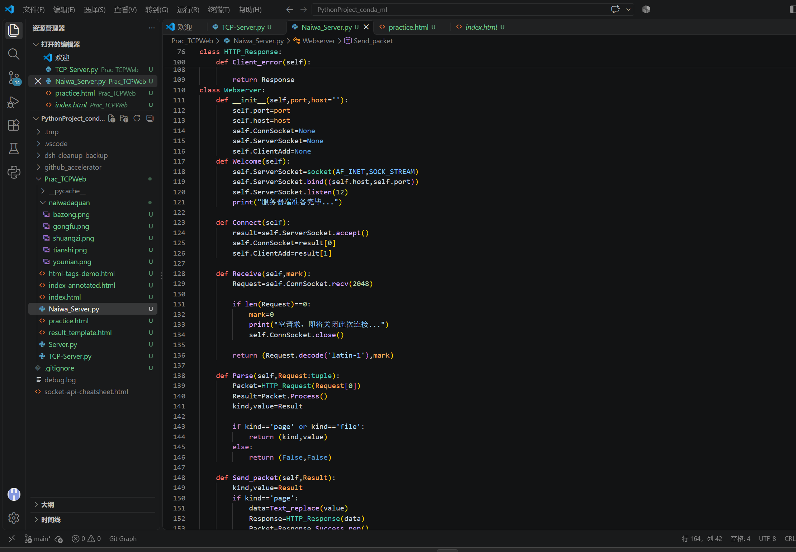
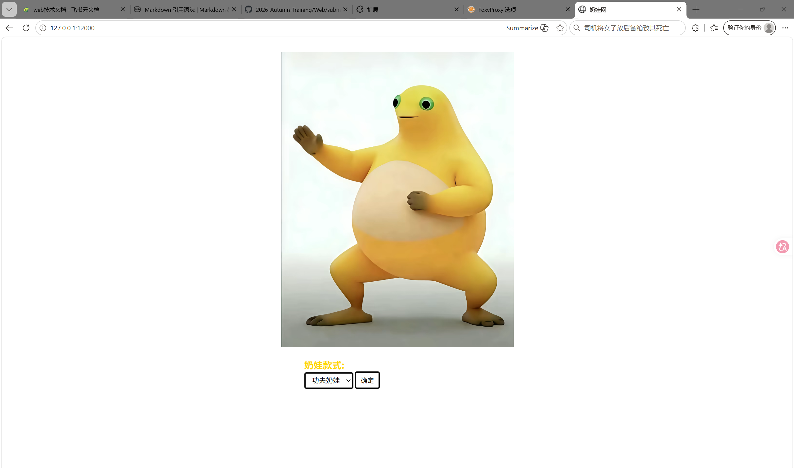
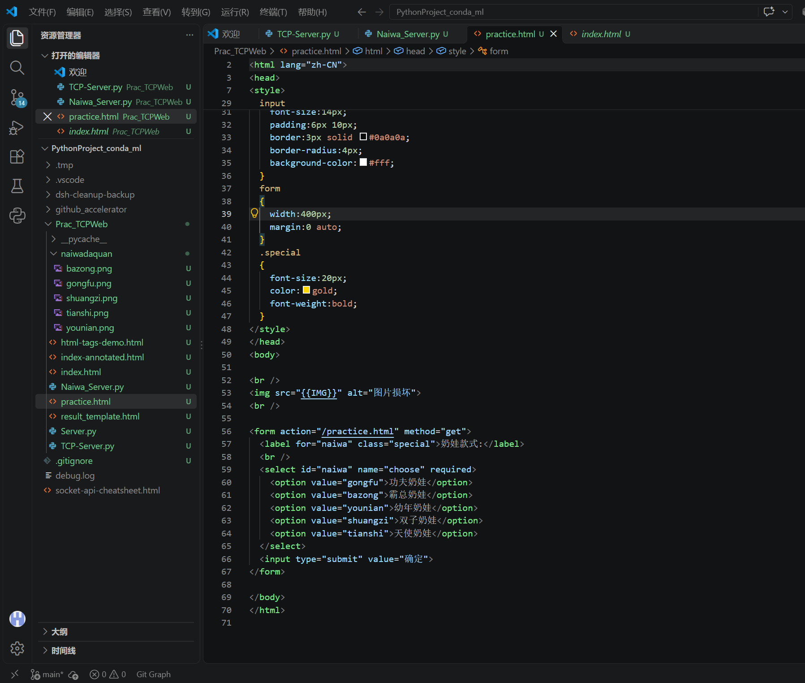

# Web 安全入门 · week1 学习总结

- **ID**：Eternity（黄河朝）
- **方向**：Web
- **日期**：2026-10-18
- **平台/来源**：飞书培训文档
- **本周范围**：抓包环境（Burp Suite + FoxyProxy）、Linux 基础命令、HTTP 协议与套接字编程以及操作系统基础

---

## 一、本周概览

| # | 学习内容 | 掌握程度 | 证据 |
|---|---------|---------|------|
| 1 | Burp Suite 安装与抓包 | 能启动、能抓到本机 HTTP 请求 | |
| 2 | FoxyProxy 代理切换 | 按规则切换代理 | |
| 3 | Linux 基础命令 | 仅书本学习，暂未搭建虚拟机环境 | |
| 4 | HTTP 请求/响应报文结构 | （能默写/能逐行分析抓到的报文） | |
| 5 | 用 Python socket 手写 HTTP 服务器 | 能响应 GET、返回文件、返回 404 | |

---

## 二、Burp Suite 的安装与配置

### 2.1 安装

- 版本：社区版 v2026.10
- 启动方式：开始菜单快捷方式

### 2.2 代理监听

- Burp 监听地址：默认 127.0.0.1:8080
- 抓到的第一个请求：来自 burpsuite 内置浏览器的 portswigger

  

### 2.3 HTTPS 证书

- 证书来源：http://burpsuite
- 导入浏览器：Edge

---

## 三、FoxyProxy 代理配置

- 代理浏览器：Edge
- 规则配置：

  

---

## 四、Linux 基础命令

- `pwd`：打印当前绝对路径
- `cd`：切换目录
- `ls -l`：列出目录详细信息
- `cat`：查看文件全部内容
- `less`：分页查看文件
- `grep`：递归搜索文件内容
- `find -name`：查找文件

---

## 五、HTTP 协议：从报文到自己的服务器

### 5.1 请求报文

- 格式：

  ```text
  请求行：方法 sp URL sp 版本 cr lf
  首部行：首部字段名: sp 值 cr lf
          首部字段名: sp 值 cr lf
  空行：cr lf
         实体体
  ```

- 常见请求方法：GET/POST/HEAD/DELETE

### 5.2 响应报文

- 格式：

  ```text
  状态行：版本 sp 状态码 sp 短语 cr lf
  首部行：首部字段名: sp 值 cr lf
          首部字段名: sp 值 cr lf
  空行：cr lf
         实体体
  ```

- `Content-Length`：实体体二进制字节数
- `Content-Type`：严格对应实体体类型，否则会信息丢失

### 5.3 用 Python socket 自己实现





---

## 六、HTML / CSS 基础

- 表单三要素：`<form action="..." method="get">` / `<input name="...">` / `<button type="submit">`
- 下拉框 `<select name="...">` 提交后会变成 URL 里的 `?name=value`
- `` 会让浏览器**再发一个请求**
- 基础标签的使用
- 小练习：

  

---

## 七、试错点

| 现象 | 原因 | 怎么解决的 |
|---|---|---|
| 浏览器提示"未发送任何数据" | 只调用了拼响应的函数，没把返回值 `sendall` 出去 | 把返回值交给 `sendall` |
| 图片显示成"图片损坏" | 图片请求没被路由 → 404 | 加静态文件兜底分支 |
| 中文乱码 / 页面截断 | `Content-Length` 用了字符数，或 charset 不一致 | 先 `encode('utf-8')` 再 `len()` |
| 未模块化服务器功能 | 相关代码杂乱 | 重构底层代码模块功能，按类分写 |
| 起初未做路径过滤 | 存在路径穿透风险 | 添加 `Path_validation` 函数解决 |
| 未更新响应报文的 Content-Type | 为类新添 type 属性 | |

---

## 八、安全相关

1. **路径穿越**：如果直接把 URL 路径拼成文件路径，`GET /../xxx` 就能读到网站目录外的文件；限制方法是先把路径规范化，再确认它仍在网站根目录内。
2. **XSS**：把用户输入原样拼进 HTML，别人输入 `<script>` 就会被当代码执行；所以输出前要转义。

---

## 九、参考

- 培训文档（飞书）
- MDN HTTP 概述：https://developer.mozilla.org/zh-CN/docs/Web/HTTP
- Python `socket` 官方文档：https://docs.python.org/zh-cn/3/library/socket.html
- 《计算机网络：自顶向下方法》
- 《Linux命令行大全》
- 《Python编程 从入门到实践》
- 《操作系统导论》
