# 
>前面已经学习HTTP TCP IP协议，前端三件套，笔记在飞书上，请移步[笔记传送门](https://my.feishu.cn/wiki/UaJswvygZiitfVkeU4ScoXaE6Pg?fromScene=spaceOverview)
## 以下是基于概念的实践
### 一：入门题目
**1.源代码查询**

**| NNSCTF新生赛**
解题思路：原网页未找到有效信息，查看源代码，发现flag
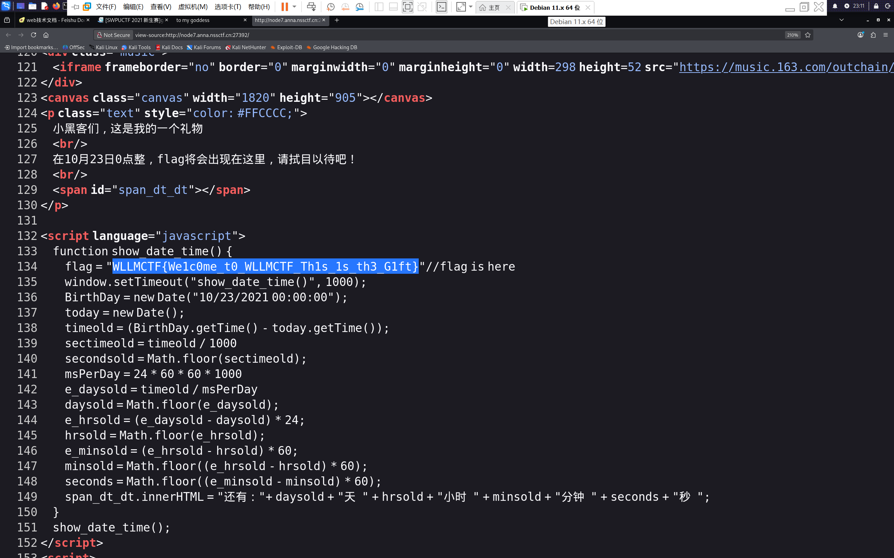

又根据题目“flag以NSSCTF提交”修改flag，提交成功
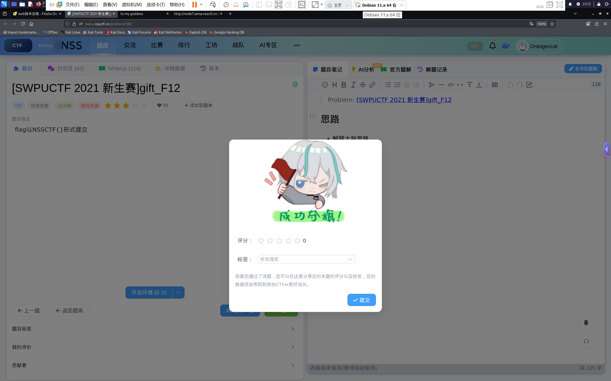

## 2.robots.txt

a.基础概念：本质上说，他就是个纯文本文件

b。作用：负责告诉爬虫那些范围可以访问，那些禁止访问（但爬虫不一定会遵守）

c。组成

**核心指令**

    User-agent:对哪个爬虫生效

    Disallow：不允许爬虫访问的路径

    allow：爬虫允许访问的路径

    sitemap：推荐爬虫或者搜索引擎抓取的内容

**规则区块**

robots.txt由一个个规则区块组成，每一个规则区块针对一个或一类爬虫

示例：
     
**禁止所有爬虫抓取含有密钥的路径**

     User-agent: *
     Disallow: /secret
     Disallow: /admin

但是这样不甚准确

**通配符**
（*和$）（一般bing和谷歌可以支持 ）

（    *    ）：精确匹配任意长的任意字符

（    $    ）:匹配URL结尾

用法举例：

(禁止抓取所有以.png结尾的文件)

    User-agent: *
    Disallow: /*.png$

(禁止抓取带有？的动态参数页面)
    
    User-agent: *
    Disallow: /*?*

>这里的*表示所有

>动态参数页面通常指URL里带有？和&的界面，服务器会根据这些参数动态生成内容

**sitemap**

让爬虫和搜索引擎更快地找到网页

    Sitemap: https://www.example.com/sitemap.xml

>注意：这里面的.xml不可更改
>但是“sitemap”可以改为自己喜欢的名字

**robots.txt练习题**

1.

依旧登录界面，尝试访问/robots.txt搜集信息，发现访问/admin.php会被重定向到/login.php

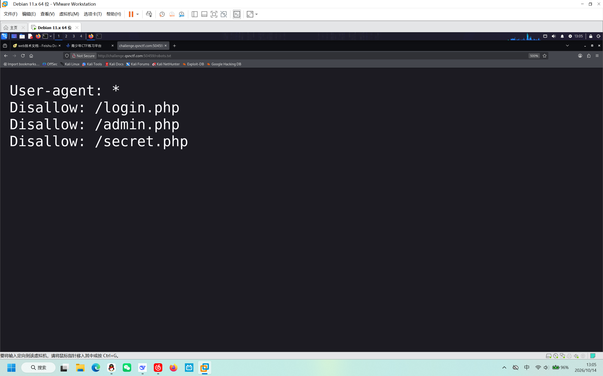

于是访问/secret.php

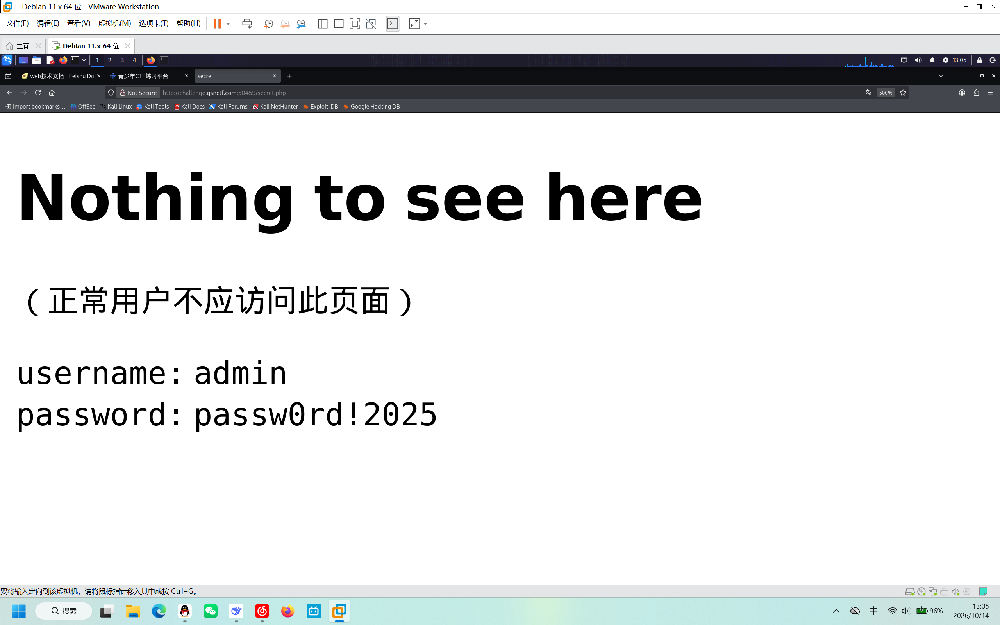

发现登录依据并登录

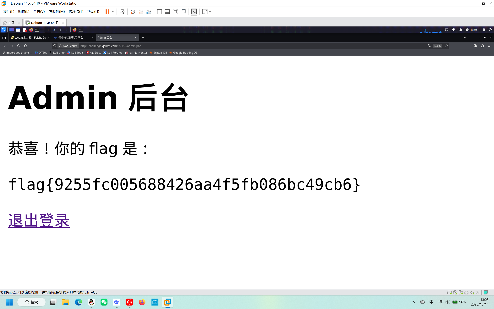

2.

依旧访问/robots.txt

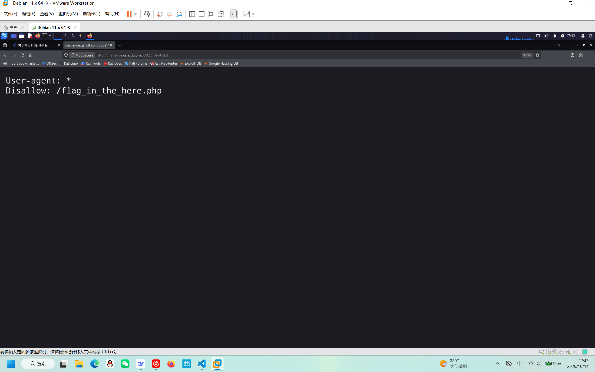

找到目标路径and光速访问、

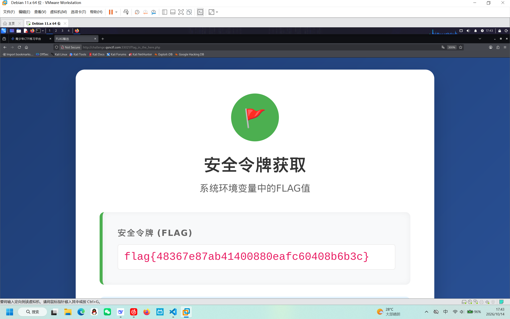

## HTTP 

### 知识点汇总：

**结构**

>请求报文：

1.请求头（header）

    Host:目标域名

    User-agent:客户端身份，可以进行修改而伪造身份

    Refer:上一个访问的网页

    Cookie:携带会话凭证

    Content-Type:告诉服务器请求体的格式

## ！空行！空行用来分开请求头与请求体，是一定存在的，否则请求体会被当做奇怪的请求头处理

2.请求体（body）

前提：只有POST/PUT方法才有

   这些常见的请求方法后面会讲到

“user=admin&password=12245”

即键=值&键=值对应content-tupe为application/x-www-form-urlencodeed(一定要对应)

其他对应：
    
    text/plain  - -  纯文本

    application/json - - eg："a":1,"b":2

    multipart/form-data 文件上传，被boundry分成多端

    。。。。。。

> 响应报文

1.响应行与状态码

响应的第一行是响应行（协议版本 状态码 响应短语，比如：OK）

    200：响应成功

    301/302：重定向- -location头指向的页面可能没做权限认证（在burpsuite中不能跟着跳转，要查看响应体）

         >location通常在响应体中的位置：

         http/1.1 200 ok

         location：http：//www.sample.com

    401：未认证- -需要登录，常见于Http Basic Auth(authentication)

          >htp basic auth（一种基础认证方式）

        用户输入用户名和密码经过Base64编码上传到
        
        服务器，再由服务器解码进行认证

    403：禁止访问- -有东西不让看，试试目录穿越或者修改UA头或者IP头绕过

    404：页面不存在

    500：服务器错误：参数里又危险函数，观察报错信息往往可以使用一下SQL注入

响应头往往看三个关键的东西

        1.set-cookie(服务器下发的cookie)

        2.server：往往可以看见部署序的服务器的版本（利用版本漏洞）

        3.location:302跳转目标

**利用命令行也可以发送请求**

    curl -v -X POST HTTP/1.1

    -H User-agent:xxxx
    -H cookie: xxxxx
     (空行)
     -d：user=admin...

>-v 打印完整的请求和响应头

>-X 指定请求方法

>-H 表示请求头（header）在这里修改请求头

>-d 请求体（body）

**常见请求方法**

                                        |       CTF考点       |
    GET:获取资源，参数放在URL query里     URL可见可改，是注入题的主战场
        > URL query:？后#前              
            >#为资源定位符
    
    POST:提交表单                        表单登录，文件上传，注意body格式由content-type决定
    
    PUT:上传/替换资源                    若webDAV配置不当，则使用getshell漏洞
    
    DELETE:删除资源                      危险操作，应该禁用这个方法
    HEAD:只要响应头。不要body             探测文件是否存在，比GET快
    
    OPTIONS:询问服务器支持哪些方法        传回的allow头可以作为攻击方式的参考

**Content-Type**

决定body的解析方式

    1.文件上传绕过：注意提交方式与文件种类对应

    2.XXE注入：将文件种类改为application/xml,上传xml body

    3.PHP 解析差异：application/json 的 Body 要用 file_get_contents('php://input') 读取，不少 " 提交了参数却没效果 " 的疑惑都源于此。

>关于3只能后面深入php的时候继续深入了

**其他值得注意的**

    1.修改语言：修改Accept/Accept-Language

    2.Authorization:Http Basic Auth用，格式为Basic Base64(username:password)

### CTF考点

**Host**

同一台服务器托管多个站点时，靠 Host 头区分。考点：

    1.越权访问内部 vhost：Host: admin.internal，配合 SSRF 章节食用。
    
    2.密码重置投毒：重置链接的域名取自 Host 头，改成攻击者域名可劫持 token。

>这个东西我只能先了解了解，以后再来探索吧

**User-agent**

    使用特定浏览器访问 在burpsuite改一行即可

**refer**
    上一个页面访问的是什么，修改即可

**X-Forword-for（XXF）**

    1.反向代理会把真实客户端IP写入X-Forword-For头

    2.通过修改XXF头为127.0.0.1

    同样的头还有X-Real-IP，X-Client-IP，Client-IP一个不行可试试别的，有时，127.0.0.1也可以简化为127.1，这取决于后台解析方式

    3.Origin：CORS中会考察Origin校验缺失

**Cookie**

    cookie的一生：首先由服务器下发到客户端，之后客户端每次访问都会携带这个cookie确认身份

        有三个关键点：
        1.cookie保存在客户端，所以可以查看和修改
        2.set-cookie：
            -路径 -httpnoly（禁止JS读取，防止XSS窃取ccokie
        3.在burp修改cookie是web安全最高频的操作

**Session**

    简单说：数据存在服务器里，而只从Session ID）发给客户端ID，之后客户每次访问，都会在cookie中带上ID，从而让服务器通过对比ID对比知道你是谁

    cookie可以查看且修改，session却没有这么随意，想破解只能猜测Session ID和服务器逻辑缺陷

NSSCTF| HTTP入门

看到一串php代码

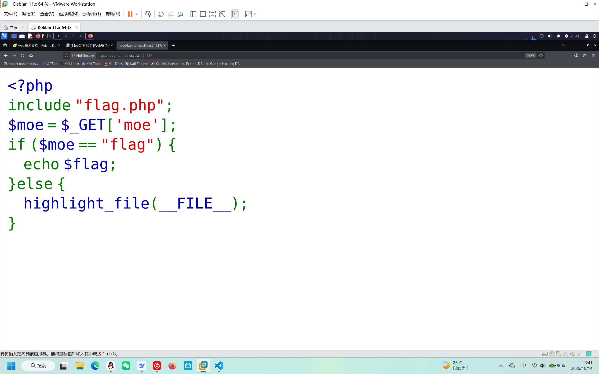

询问AI发现是关于PHP的代码审计
但是根据我自己的理解结合AI是这样理解：本题通过php代码可知是在URL中使用GET修改问号后参数访问

（截止10/15我还没开始正式学习php，只能等后面学了在回头叭！）

>问号（？）主要起到一个分隔符的作用，后跟要传的参数

由php代码可知问号后的参数为moe 值为flag————？moe=flag

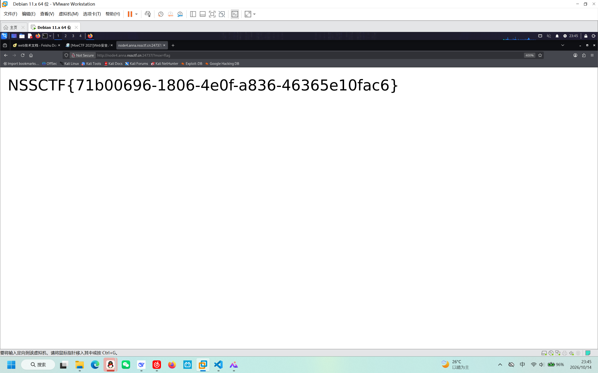

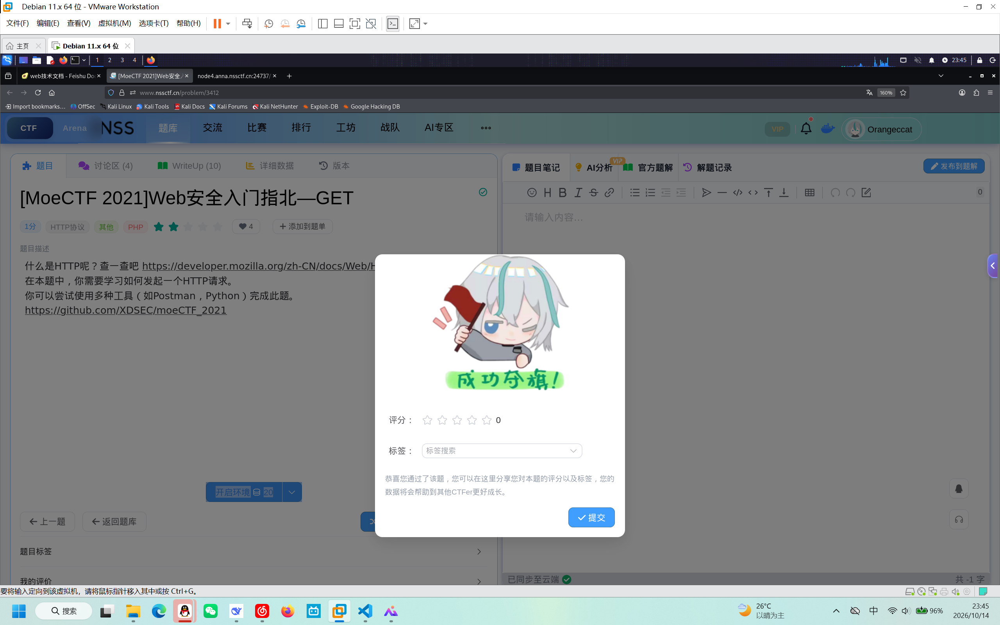

## Liunx再回顾（我亲爱的kali！）

>版本我就不赘述了，除了deepin和RHEL其他的发行版我都体验过，最近想试试fedora

**内核**

指提供硬件抽象层，硬盘，文件系统的控制

**shell**

用户和内核交互的纽带

>注意：内核只是操作系统的主要部分 | 操作系统=内核+用户空间的各种系统软件

**特点**：Linux“一切皆文件”

**重要文件/路径**

    /etc  >系统配置，纯文本，改坏了也能改回来
    /home >用户的家目录，重装系统通常单独保留这一块
    /proc >内核的现场状态（不占磁盘，读他时才产生）
    /bin,/user/bin >可执行程序，命令的大本营
    /var/log >日志，出问题第一个看这里
    /dev >设备文件，磁盘是/dev/sda,"什么都没有"是/dev/null

**Linux练习题**

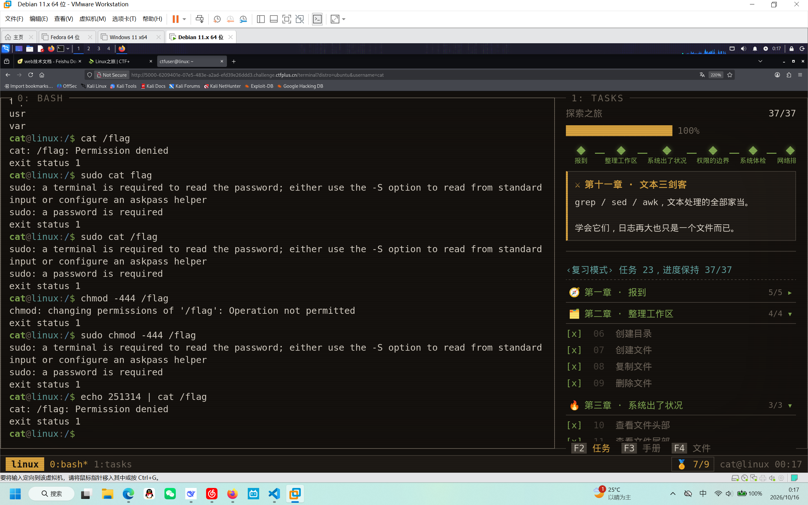

# 感谢能看到这里！